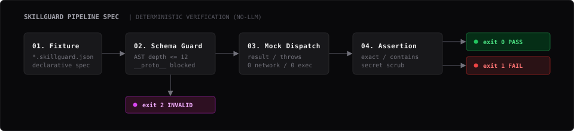

<p align="center">
  
</p>

<p align="center">
  <strong>Deterministic, zero-LLM test runner for Agent Skills and MCP Tools.</strong><br>
  Write declarative mock tool-call assertions, test locally or in CI, and catch tool mismatch regressions in sub-seconds.
</p>

<p align="center">
  <a href="#test-matrix"></a>
  <a href="#deterministic-engine"></a>
  <a href="#zero-friction-quickstart"></a>
  <a href="#no-network"></a>
  <a href="#secret-protection"></a>
  <a href="LICENSE"></a>
</p>

---

## ⚡ Why SkillGuard?

Building agentic workflows with Agent Skills and Model Context Protocol (MCP) tools creates a new class of bugs: **agents calling the right tool with the wrong arguments, skipping prerequisites, or leaking production credentials in telemetry**.

Benchmarking these skills with LLM-as-a-judge is slow, expensive, and non-deterministic. **SkillGuard provides a fast, deterministic local signal before shipping.**

| Capability | Traditional LLM-as-a-Judge | SkillGuard Mock Runner |
|:---|:---:|:---:|
| **Execution Time** | 15 – 60 seconds / test | **< 1.0 second for entire suite** |
| **Token Cost** | \$\$ per CI run | **\$0.00 (Zero tokens, zero API keys)** |
| **Test Stability** | Flaky (temperature jitter) | **100% byte-identical repeatable diffs** |
| **Network Egress** | Requires external API connection | **Airgapped (Zero network sockets)** |
| **Secret Protection** | Risk of leaking keys in prompts | **Automated multi-layer secret redaction** |
| **Exit Code Protocol** | Complex parsing required | **Native exit codes: `0` Pass, `1` Fail, `2` Invalid** |

---

## 🖥️ Terminal Demo Walkthrough

### 1. Passing Test Suite
Run assertions on all fixtures in a directory with instant verification:

```bash
node src/cli.js test fixtures/pass
```

```
SkillGuard 0.1.0
PASS fixtures/pass/basic.skillguard.json
  PASS calls weather with the expected city and units

PASS fixtures/pass/edge.skillguard.json
  PASS subset args with extra recorded calls
  PASS unicode arguments
  PASS no calls expected

PASS fixtures/pass/redaction.skillguard.json
  PASS sensitive arguments match
Summary: 3 fixture(s), 5 case(s), 5 passed, 0 failed
Result: PASS
```

### 2. Failure Detection with Clear Diffs & Auto-Redaction
When an agent calls a tool with invalid arguments or skips a call, SkillGuard pinpoints the exact mismatch while **automatically scrubbing sensitive credentials**:

```bash
node src/cli.js test fixtures/fail/wrong-arguments.skillguard.json
```

```
SkillGuard 0.1.0
FAIL fixtures/fail/wrong-arguments.skillguard.json
  FAIL wrong city argument
    call 1 arguments.city: expected "Jakarta", got "Bandung"
  FAIL missing second call
    call 2: missing expected call "search.web"
Summary: 1 fixture(s), 2 case(s), 0 passed, 2 failed
Result: FAIL
```

### 3. Strict Pre-Execution Validation
Malformed inputs, oversized payloads, or prototype pollution attempts are blocked **before** executing any test case:

```bash
node src/cli.js test fixtures/invalid/dangerous-key.skillguard.json
```

```
SkillGuard 0.1.0
INVALID fixtures/invalid/dangerous-key.skillguard.json
  fixture.cases[0].calls[0].arguments.__proto__: forbidden key
Summary: 1 fixture(s), 0 case(s), 0 passed, 0 failed, 1 invalid
Result: INVALID
```

### 4. Machine-Readable CI Output
Integrate directly with CI pipelines, bots, or dashboards via `--json`:

```bash
node src/cli.js test fixtures/pass --json
```

---

## 🚦 Exit Code Specification

SkillGuard enforces strict exit code semantics for seamless CI/CD gatekeeping:

- **`0` (PASS)**: All fixtures and test cases passed their assertions.
- **`1` (FAIL)**: Fixture syntax was valid, but one or more assertions failed.
- **`2` (INVALID / USAGE)**: Fixture failed schema validation, violated security boundaries, or CLI options were invalid.

---

## 🚀 Zero-Friction Quickstart

### Step 1: Clone or Install
Requires **Node.js 20+**. Zero external dependencies are installed.

```bash
git clone https://github.com/openbot/skillguard.git
cd skillguard
```

### Step 2: Write a Fixture (`weather-test.skillguard.json`)
A fixture defines mock tools, simulated agent actions, and expectations:

```json
{
  "version": 1,
  "name": "weather-skill-test",
  "tools": {
    "weather.get": { "result": { "city": "Bandung", "tempC": 24 } },
    "db.audit": { "result": { "logged": true } }
  },
  "cases": [
    {
      "name": "fetches weather for requested city",
      "calls": [
        { "tool": "weather.get", "arguments": { "city": "Bandung" } }
      ],
      "expect": {
        "mode": "exact",
        "calls": [
          { "tool": "weather.get", "arguments": { "city": "Bandung" } }
        ]
      }
    }
  ]
}
```

### Step 3: Run the Test
```bash
node src/cli.js test fixtures/pass/basic.skillguard.json
```

### Step 4: Drop into GitHub Actions (`.github/workflows/ci.yml`)
Add zero-token skill testing directly to your PR review gate:

```yaml
name: SkillGuard CI
on: [push, pull_request]

jobs:
  test:
    runs-on: ubuntu-latest
    steps:
      - uses: actions/checkout@v4
      - uses: actions/setup-node@v4
        with:
          node-version: '20'
      - name: Verify Core Unit Tests
        run: npm test
      - name: Run SkillGuard Fixture Suite
        run: node src/cli.js test fixtures/pass
```

---

## 🧩 Matching Strategies & Capabilities

| Matching Mode | Syntax | Description |
|:---|:---|:---|
| **Exact** *(Default)* | `"mode": "exact"` | Enforces strict 1-to-1 match on call count, tool name, and argument payload. |
| **Contains** | `"mode": "contains"` | Matches expected calls in sequential order while ignoring unasserted intermediate calls. |
| **Subset Arguments** | `"match": "subset"` | Asserts only specified keys in `arguments`, ignoring dynamic fields like `timestamp` or `requestId`. |
| **Wildcard Arguments**| Omit `arguments` | Asserts that a tool was called without restricting its parameter values. |
| **Tool Throws Simulation** | `"throws": { ... }` | Simulates downstream tool failures (`{ message, code }`) to test agent error recovery. |

---

## 🛡️ Security & Resource Limits (v0.1)

SkillGuard is engineered to execute safely even on untrusted user-submitted fixtures:

- **Resource Limits:** File size $\le$ 256 KiB, JSON depth $\le$ 12, string $\le$ 8,192 chars, array $\le$ 500 items, object $\le$ 200 keys, $\le$ 64 tools, $\le$ 200 cases, $\le$ 100 calls per case, $\le$ 50,000 JSON nodes.
- **Prototype Defense:** Keys `__proto__`, `prototype`, and `constructor` are immediately rejected.
- **Terminal Armor:** ANSI escapes and directional formatting control characters are sanitized to prevent terminal hijacking.
- **Secret Redaction:** High-entropy tokens, sensitive keys (`password`, `token`, `secret`, `apikey`), and copula text assignments are scrubbed in diffs.

---

## 📚 Deep Dive Documentation

Detailed architectural specifications and guides are available in the [`docs/`](docs/) directory:

- 📖 **[Architecture & Runtime Specification](docs/spec-architecture.md)** — Pipeline stages, determinism guarantees, and security model.
- 🛠️ **[Fixture Authoring Guide](docs/fixture-guide.md)** — Comprehensive guide with recipes, edge cases, and troubleshooting tips.

---

## 🧪 Development & Testing

Run the full unit and security test suite:

```bash
npm test
```

Expected output: `72 pass, 0 fail` in `< 1.0s`.
