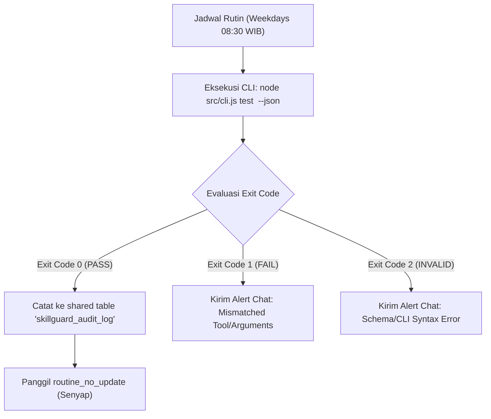

# OpenBot Routine Integration Guide for SkillGuard

> **Status:** Integration Design & Operational Guide<br>
> **Scope:** Automated Periodic Skill Verification for Local OpenBot Agents<br>
> **Safety Level:** Read-Only Audit & Template Provision (Zero Active Modifications without User Consent)

---

## 1. Pendahuluan

SkillGuard dirancang untuk memberikan umpan balik deterministik dan cepat (<1s) mengenai kepatuhan tool-calling pada Agent Skills. Dokumen ini menjelaskan tata cara mengintegrasikan verifikasi otomatis berkala ke dalam sistem rutinitas OpenBot secara aman, andal, dan minim kebisingan (*low noise*).

---

## 2. Prinsip & Batasan Operasional (*Safety Boundaries*)

1. **Larangan Aktivasi Tanpa Izin:** Seluruh berkas konfigurasi rutinitas yang disediakan dalam repositori ini berstatus contoh konfigurasi manual non-aktif (`"active": false`). **Tidak ada rutinitas server OpenBot yang diubah, dibuat, atau diaktifkan** dalam pengerjaan SG-07.
2. **Tanpa Egress & Tanpa Efek Samping:** Pengujian berjalan 100% lokal di mesin pengembang (`node src/cli.js test ...`). Rutinitas tidak boleh melakukan `git commit`, `git push`, publish npm, atau memanggil endpoint jaringan luar.
3. **Pola Pelaporan Senyap (*Quiet on Success*):** Jika seluruh pengujian lulus (Exit Code 0), rutinitas wajib memanggil `routine_no_update` atau mencatat status ke tabel data bersama secara senyap tanpa membanjiri ruang obrolan (*chat clutter*). Notifikasi hanya dikirim jika terjadi kegagalan (Exit Code 1) atau error skema (Exit Code 2).
4. **Proteksi Kredensial:** Data sensitif tidak boleh disimpan pada tabel bersama. SkillGuard secara otomatis menyensor token atau kredensial dalam pesan kegagalan (`[REDACTED]`).

---

## 3. Arsitektur Alur Rutinitas



---

## 4. Penjadwalan & Penghindaran Tabrakan (*Collision Avoidance*)

Audit daftar rutinitas live OpenBot per **2026-11-05** menunjukkan status faktual sebagai berikut (seluruh waktu dalam zona `Asia/Jakarta`):

### A. Rutinitas Aktif Saat Ini
- **Project Manager** (`agent-c5ae563a-562d-469c-b75d-871c0c4fe0bc`):
  - Nama: `SkillGuard — status harian`
  - Jadwal: **Weekdays 09:30 WIB** (`active: true`)
- **Ops Planner** (`agent-7b597647-5e2e-4220-b458-43fe7cedf6d4`):
  - Nama: `SkillGuard — audit operasional mingguan`
  - Jadwal: **Senin 09:00 WIB** (`active: true`)

### B. Rutinitas Non-aktif / Standby
- **QA Tester** (`agent-8bae0fb7-2ff3-490d-a3b8-9d97f52e3f94`):
  - Nama: `Weekday smoke check` — Weekdays 09:00 WIB (`active: false`)
- **PR Shepherd** (`agent-2100c4f9-02b4-4f30-8a65-0c56d0df9904`):
  - Nama: `PR check — morning` — Weekdays 10:00 WIB (`active: false`)
  - Nama: `PR check — afternoon` — Weekdays 15:00 WIB (`active: false`)
- **Dr. Addbot** (`agent-ff0fc508-3133-46d8-91e6-ccbdf7aaa3b5`):
  - Nama: `transcript-healthcheck` & `routine-healthcheck` (`active: false`)

### Rekomendasi Waktu Uji SkillGuard
Berdasarkan status live di atas, jika pengguna memutuskan untuk mengaktifkan audit verifikasi skill di masa mendatang:
- Waktu yang dianjurkan adalah **Weekdays 08:30 WIB** (atau alternatif **11:00 WIB**).
- Waktu 08:30 WIB berjalan 30 menit sebelum jadwal mingguan Ops Planner (Senin 09:00) dan 1 jam sebelum laporan harian PM (09:30), sehingga tidak menimbulkan benturan waktu maupun tumpang-tindih eksekusi (*zero collision*).

---

## 5. Contoh Konfigurasi Manual Non-aktif (`templates/skillguard-routine.json`)

> **Catatan Status Template:** Berkas `templates/skillguard-routine.json` disediakan sebagai **contoh konfigurasi manual non-aktif** untuk referensi penyiapan. Berkas ini bukan format impor otomatis bawaan server OpenBot, melainkan panduan struktur yang dapat dibaca dan diterapkan secara manual atau via perintah jika pengguna menyetujuinya.

```json
{
  "$schema": "https://openbot.local/schemas/routine.json",
  "name": "skillguard-periodic-verification",
  "description": "Contoh konfigurasi manual non-aktif untuk verifikasi periodik deterministik skill lokal menggunakan SkillGuard.",
  "active": false,
  "timezone": "Asia/Jakarta",
  "schedule": {
    "kind": "weekdays",
    "time": "08:30"
  },
  "instruction": "Jalankan verifikasi deterministik lokal pada fixture skill OpenBot menggunakan CLI SkillGuard.\n\nInstruksi Kerja (Pseudocode Agen):\n1. Eksekusi perintah command-line lokal: 'node src/cli.js test templates/openbot-skill.skillguard.json --json' di direktori /Users/rizkysap/OpenBot/Shared/SkillGuard menggunakan kemampuan eksekusi shell/terminal lokal yang didukung agen pelaksana.\n2. Evaluasi kode keluar (Exit Code):\n   - Exit Code 0 (PASS): Seluruh ekspektasi cocok. Catat riwayat audit ke shared table 'skillguard_audit_log' jika tersedia, lalu senyap dengan memanggil routine_no_update.\n   - Exit Code 1 (FAIL): Asersi fixture gagal. Laporkan ringkasan kegagalan ke chat mencakup tool atau argumen yang tidak cocok (kredensial otomatis disensor oleh SkillGuard).\n   - Exit Code 2 (INVALID): Kesalahan skema fixture atau sintaks CLI. Laporkan error agar fixture diperbaiki.\n3. Batasan Keamanan:\n   - Dilarang memanggil endpoint jaringan luar atau model LLM evaluasi.\n   - Dilarang melakukan git commit, push, atau publish.\n   - Jaga seluruh laporan tetap lokal dan rapi.",
  "limitPolicy": "wait",
  "missedPolicy": "skip"
}
```

### Verifikasi Tool Eksekusi pada Runtime Rutinitas
Dalam lingkungan runtime OpenBot:
- Rutinitas dijalankan sebagai sesi agen baru berbasis teks instruksi di atas.
- Pemanggilan command shell dilakukan melalui kemampuan terminal/shell lokal yang terpasang pada agen yang ditugaskan (misal: runner bash/terminal agen).
- Tool OpenBot resmi yang digunakan secara langsung oleh runtime untuk manajemen rutinitas adalah:
  - `routine_no_update`: Panggilan standar OpenBot saat rutinitas selesai tanpa perlu mengirim pesan chat baru.
  - `openbot.query_data` / `openbot.execute_data`: Panggilan standar untuk membaca atau mencatat ringkasan ke database bersama (`Shared`).

---

## 6. Prosedur Aktivasi (Hanya Jika Diminta Eksplisit oleh Pengguna)

Jika pengguna secara eksplisit meminta pengaktifan rutinitas ini:
1. Konfirmasikan agen yang akan menjadi pemilik rutinitas (misal: QA Tester atau Ops Planner).
2. Panggil tool bawaan `openbot.create_routine` dengan parameter dari berkas referensi dan nilai `active: true`.
3. Verifikasi hasil pendaftaran melalui `openbot.list_routines`.
