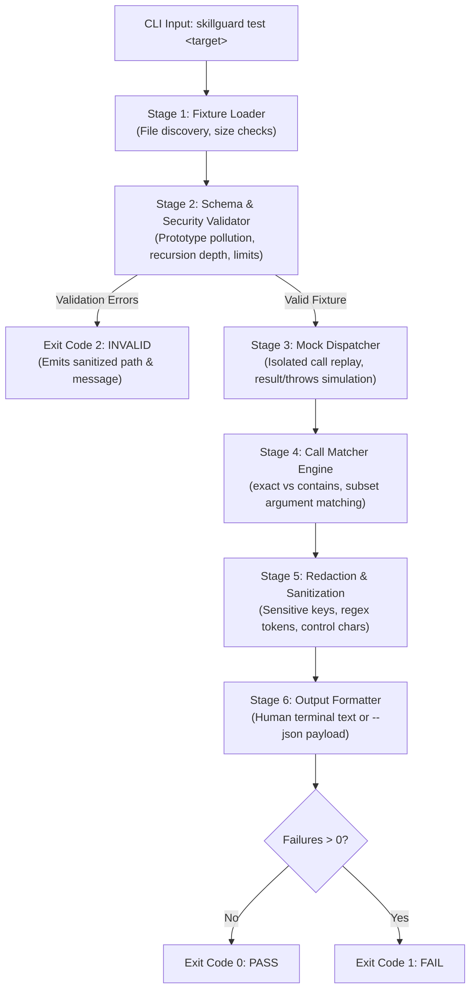

# SkillGuard Architecture & Specification

> **Version:** 0.1.0  
> **Status:** Production / Implemented  
> **Classification:** Deterministic Mock Test Runner for Agent Skills & MCP Tools

---

## 1. Executive Summary

SkillGuard is a specialized, zero-overhead testing harness designed specifically for **Agent Skills** and **MCP (Model Context Protocol) Tools**. 

While general AI evaluation frameworks rely on LLM-as-a-judge (introducing flakiness, latency, cost, and non-deterministic scoring), SkillGuard operates on a **purely deterministic, declarative mock assertion model**:
- **0 Token Spend:** Runs entirely on local compute without calling any LLM APIs.
- **Sub-Second Speed:** Executes full test suites in <1,000 ms.
- **Byte-Identical Determinism:** Produces stable, byte-identical output across repeated runs with zero timestamp jitter or unordered map leaks.
- **Zero-Trust Security:** Enforces strict JSON schema validation, deep nesting bounds, prototype-pollution defenses, and automated multi-layer secret redaction.

```
┌─────────────────────────────────────────────────────────────────────────────┐
│                            SKILLGUARD RUNTIME                               │
│                                                                             │
│   ┌─────────────┐       ┌──────────────┐       ┌────────────────────────┐   │
│   │   Fixture   │ ───►  │  Validation  │ ───►  │   Mock Tool Dispatch   │   │
│   │   Loader    │       │   & Limits   │       │   (0 real code exec)   │   │
│   └─────────────┘       └──────────────┘       └────────────────────────┘   │
│                                                             │               │
│                                                             ▼               │
│   ┌─────────────┐       ┌──────────────┐       ┌────────────────────────┐   │
│   │  Exit Code  │ ◄───  │    Secret    │ ◄───  │      Call Matcher      │   │
│   │   Mapper    │       │  Redaction   │       │   (Exact / Contains)   │   │
│   └─────────────┘       └──────────────┘       └────────────────────────┘   │
└─────────────────────────────────────────────────────────────────────────────┘
```

---

## 2. Execution Pipeline Lifecycle

Every invocation of `skillguard test <target>` passes through a unidirectional six-stage pipeline:



### Stage 1: Fixture Loader (`src/loader.js`)
- Resolves single file targets or recursively scans directories for `*.skillguard.json`.
- Enforces a strict file-size limit (`≤ 256 KiB`) before parsing to prevent memory exhaustion attacks.
- Paths are resolved and normalized relative to the current working directory to guarantee portable execution across environments.

### Stage 2: Schema & Security Validator (`src/schema.js`)
Validates structural integrity before **any** mock execution takes place:
1. **Schema Integrity:** Verifies required fields (`version: 1`, `name`, `tools`, `cases`).
2. **Prototype Pollution Protection:** Recursively scans and forbids `__proto__`, `prototype`, and `constructor` keys across all input objects.
3. **Identifier Sanitization:** Rejects tool names with control characters, whitespace, or invalid syntax (`^[A-Za-z0-9][A-Za-z0-9_.:-]{0,119}$`).
4. **Boundary Checks:** Blocks inputs exceeding depth (`≤ 12`), string lengths (`≤ 8,192`), array lengths (`≤ 500`), object key counts (`≤ 200`), tool declarations (`≤ 64`), and case declarations (`≤ 200`).
5. **Safe Number Enforcement:** Rejects non-finite numbers and integers exceeding JavaScript safe integer bounds (`Number.isSafeInteger`).

### Stage 3: Mock Dispatcher (`src/dispatcher.js`)
- Emulates MCP tool or Skill call responses using declarations in `tools`.
- Tools can simulate two deterministic behaviors:
  - `result`: Resolves with a mock data object (deep-cloned via `cloneJson` to prevent mutation leaks).
  - `throws`: Simulates downstream tool failure with a deterministic error object (`{ message, code }`).
- **Zero Real Code Execution:** No user scripts, MCP child processes, or agent runtimes are executed. Mocks are purely declarative in-memory state machines.

### Stage 4: Call Matcher Engine (`src/matcher.js`)
Compares the recorded sequence of agent calls against the `expect` block:
- **`mode: "exact"` (default):** Requires a 1-to-1 match in call count, tool name, and call ordering.
- **`mode: "contains"`:** Allows extraneous intermediate or surrounding tool calls, asserting that the expected sequence appears in order.
- **Argument Comparison:**
  - Full match: Deep equality comparison of argument trees with stable key traversal.
  - `match: "subset"`: Asserts only that specified argument keys and values match, ignoring extra arguments emitted by the agent.
  - Wildcard: Omitting `arguments` entirely in an expected call asserts that the tool was invoked regardless of its parameters.

### Stage 5: Secret Redaction & Sanitization (`src/redact.js`, `src/sanitize.js`)
Guarantees that test failures, assertion diffs, and error messages never leak credentials to console logs, CI output, or storage:
1. **Sensitive Key Names:** Redacts values under keys containing sensitive words (`password`, `token`, `secret`, `apikey`, `privatekey`, `session`, `auth`, `bearer`, etc.).
2. **High-Entropy Secret Patterns:** Automatic regex-based detection and redaction for OpenAI (`sk-...`), Anthropic (`sk-ant-...`), Stripe (`sk_live_...`), GitHub PAT (`ghp_...`, `github_pat_...`), AWS keys (`AKIA...`), JWT tokens, PGP private blocks, database connection strings, and generic high-entropy hex strings.
3. **Conversational Heuristics:** Redacts copula assignments in free-text messages (e.g. `password is secret123`, `api_key = abcde12345`).
4. **Terminal Sanitization:** Strips or escapes ANSI escape codes and Unicode bidirectional formatting characters (`\u202A`–`\u202E`) to protect developer terminals from visual spoofing.

### Stage 6: Deterministic Reporter (`src/report.js`)
- **Human Reporter:** Emits clean, indentation-structured text with relative paths, clear failure diffs, and summary counters.
- **JSON Reporter (`--json`):** Emits machine-parseable JSON adhering to the `skillguard: 0.1.0` schema contract for CI/CD integration.
- Stable property ordering is enforced so identical fixtures yield byte-identical test outputs on repeat runs.

---

## 3. Exit Code Contract

SkillGuard establishes a strict exit code protocol suitable for CI pipelines, automated branch protection, and local pre-commit hooks:

| Exit Code | Status | Condition | Example Scenario |
|:---:|:---|:---|:---|
| `0` | **PASS** | All fixtures and cases passed their assertions. | All expected tool calls and arguments matched. |
| `1` | **FAIL** | Fixture was syntactically valid, but assertions failed. | Agent called `weather.get` with `"city": "Bandung"` instead of `"Jakarta"`. |
| `2` | **INVALID / USAGE** | Fixture failed validation, input was malformed, or CLI flags were invalid. | Fixture exceeds depth 12, contains forbidden keys (`__proto__`), or calls an undeclared tool. |

---

## 4. Resource & Constraint Envelope

To guarantee predictable latency and prevent DoS vectors when running untrusted test fixtures, SkillGuard enforces the following hard limits:

| Parameter | Limit | Failure Reason |
|:---|:---:|:---|
| **Max Fixture File Size** | `256 KiB` | Prevents high memory consumption during file loading |
| **Max Object / Array Depth** | `12 levels` | Prevents call stack overflow during recursive traversal |
| **Max String Length** | `8,192 chars` | Bounds string comparison complexity |
| **Max Array Length** | `500 elements` | Limits iteration overhead in arrays |
| **Max Object Keys** | `200 keys` | Bounds object dictionary operations |
| **Max Tools Declared** | `64 tools` | Prevents oversized mock registries |
| **Max Cases Per Fixture** | `200 cases` | Caps per-fixture case count |
| **Max Calls Per Case** | `100 calls` | Bounds sequence matcher matrix |
| **Max Total JSON Nodes** | `50,000 nodes` | Prevents JSON bomb / memory bloating attacks |
| **Execution Time Target** | `< 3.0 seconds` | Unit test suite benchmarks at ~900 ms for 72 test suites |

---

## 5. Security & Isolation Model

### 1. Zero Network & Dynamic Execution Isolation
SkillGuard tests explicitly assert that the runtime imports zero networking libraries (`http`, `https`, `net`, `fetch`, `XMLHttpRequest`, `WebSocket`) and contains no dynamic code generation (`eval`, `new Function`). The test suite runs in an air-gapped environment.

### 2. Prototype Pollution Defense
Any fixture payload containing `__proto__`, `constructor`, or `prototype` is discarded at Stage 2 with Exit Code `2`. All internal dictionaries use clean prototype objects (`Object.hasOwn` or `Map`).

### 3. Redaction Precedence
Redaction is applied recursively to failure values before rendering diffs. When an expected vs actual value differs:
- If the argument path is classified as sensitive (e.g. `arguments.credentials.apiKey`), the diff outputs:
  ```
  arguments.credentials.apiKey: expected [REDACTED], got [REDACTED]
  ```
- If an unclassified key contains a known token pattern, only the secret substring is scrubbed, preserving the surrounding diagnostic structure without leaking the credential.

---

## 6. Architectural File Index

| File | Purpose |
|:---|:---|
| `src/cli.js` | Command-line interface parser, help text, exit code orchestrator |
| `src/loader.js` | Filesystem traversal and size-bounded JSON loading |
| `src/schema.js` | AST validation, structural limits, and prototype pollution guards |
| `src/dispatcher.js` | In-memory mock tool call dispatcher (`result` and `throws`) |
| `src/matcher.js` | Sequence comparison, subset matching, and diff generation |
| `src/redact.js` | Secret redaction, regex detectors, and conversational heuristics |
| `src/sanitize.js` | Terminal control character and bidi Unicode sanitizer |
| `src/json.js` | Stable JSON stringifier, deep equality, and object cloner |
| `src/report.js` | Human terminal formatter and structured JSON report generator |
| `src/version.js` | Canonical semver version declaration (`0.1.0`) |
